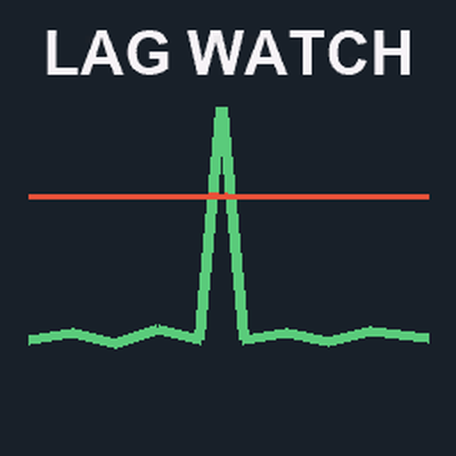

# ModHub upload: Server Lag Watch

What to enter in the GIANTS ModHub upload form for this mod. Each text box below has a copy button on GitHub.



**Mod Icon (512x512):** [`icon_512.png`](icon_512.png)

| Field | Value |
|-------|-------|
| Title English | Server Lag Watch |
| Title German | Server Lag Watch |
| Title French | Server Lag Watch |
| Version | `1` `6` `0` `0` |
| Author | DTM Mods, PropaineX |
| Manufacturer | Lizard |
| Category 1 | Gameplay |
| Category 2 | Not Set |
| Category 3 | Not Set |

## Title English
```text
Server Lag Watch
```

## Title German
```text
Server Lag Watch
```

## Title French
```text
Server Lag Watch
```

## Description English
```text
Description: Finds out which mod freezes your server. Every freeze over a quarter of a second is shown to every player and written to the server log, with the mod script or the save that caused it.
Hotkeys: none, it works on its own. Install it on the server and on every player's game.
GitHub: https://github.com/DTM-Mods/FS25_ServerLagWatch

Whenever the server stops for longer than a quarter of a second, every player gets a notification on screen: how long the server froze and which mod script was the slowest at that moment. The same line is written to the server log, so the cause can be found afterwards.

Time is added up per script over the whole frame, so many small calls still show ("300 ms in 20 calls"), and the game's own updateables, systems and managers are timed too. Each freeze line splits the time into watched scripts and time outside them: when "outside" is most of it, the engine or untimed base-game code caused the freeze, not a mod.

Every time the server saves the game, every player sees big red "SERVER SAVE" letters in the middle of the screen until the save is done.

When the server stops answering for 3 seconds, every player sees big red "SERVER LAG WATCH" letters in the middle of the screen until it answers again.

Apart from that it changes nothing in the game, it only measures and reports.

Changelog 1.6.0.0:
- The profanity filter moved to its own mod, FS25_NoProfanityFilter. Install that one to keep chat, names and license plates unfiltered.

Changelog 1.5.1.0:
- The "SERVER SAVE" letters and the freeze notification are in all 27 game languages: every player reads them in their own language.
- Description in all 27 languages.
```

## Description German
```text
Beschreibung: Findet heraus, welcher Mod deinen Server einfrieren lässt. Jeder Hänger über eine Viertelsekunde wird jedem Spieler angezeigt und ins Server-Log geschrieben, mit dem Mod-Skript oder dem Speichern als Ursache.
Tastenkombinationen: keine, der Mod arbeitet von selbst. Auf dem Server und im Spiel jedes Spielers installieren.
GitHub: https://github.com/DTM-Mods/FS25_ServerLagWatch

Sobald der Server länger als eine Viertelsekunde stehen bleibt, bekommt jeder Spieler eine Meldung auf den Bildschirm: wie lange der Server eingefroren war und welches Mod-Skript in diesem Moment am langsamsten war. Dieselbe Zeile wird ins Server-Log geschrieben, damit die Ursache auch später noch gefunden werden kann.

Die Zeit wird pro Skript über den ganzen Frame zusammengezählt, damit auch viele kleine Aufrufe auffallen ("300 ms in 20 Aufrufen"), und die Updateables, Systeme und Manager des Spiels werden ebenfalls gemessen. Jede Hänger-Zeile im Log teilt die Zeit in gemessene Skripte und Zeit außerhalb: Ist "outside" der größte Teil, war die Engine oder ungemessener Basisspiel-Code die Ursache, kein Mod.

Jedes Mal, wenn der Server das Spiel speichert, sieht jeder Spieler große rote Buchstaben "SERVER SPEICHERT" in der Mitte des Bildschirms, bis das Speichern fertig ist.

Wenn der Server 3 Sekunden lang nicht antwortet, sieht jeder Spieler große rote Buchstaben "SERVER LAG WATCH" in der Mitte des Bildschirms, bis er wieder antwortet.

Abgesehen davon ändert er nichts am Spiel, er misst nur und meldet.

Changelog 1.6.0.0:
- Der Schimpfwortfilter ist in einen eigenen Mod umgezogen, FS25_NoProfanityFilter. Diesen installieren, damit Chat, Namen und Kennzeichen weiter ungefiltert bleiben.

Changelog 1.5.1.0:
- Die Buchstaben "SERVER SPEICHERT" und die Hänger-Meldung gibt es in allen 27 Sprachen des Spiels: Jeder Spieler liest sie in seiner eigenen Sprache.
- Beschreibung in allen 27 Sprachen.
```

## Description French
```text
Description : trouve le mod qui fait geler ton serveur. Chaque gel de plus d'un quart de seconde est affiché à tous les joueurs et écrit dans le journal du serveur, avec le script du mod ou la sauvegarde qui l'a causé.
Raccourcis : aucun, il fonctionne tout seul. À installer sur le serveur et dans le jeu de chaque joueur.
GitHub: https://github.com/DTM-Mods/FS25_ServerLagWatch

Dès que le serveur s'arrête plus d'un quart de seconde, chaque joueur reçoit une notification à l'écran : combien de temps le serveur a gelé et quel script de mod était le plus lent à ce moment-là. La même ligne est écrite dans le journal du serveur, pour retrouver la cause plus tard.

Le temps est additionné par script sur toute l'image, donc beaucoup de petits appels apparaissent aussi ("300 ms en 20 appels"), et les updateables, systèmes et gestionnaires du jeu sont mesurés eux aussi. Chaque ligne de gel du journal sépare le temps des scripts mesurés et le temps en dehors : quand "outside" en est la plus grande partie, c'est le moteur ou du code non mesuré du jeu de base qui a causé le gel, pas un mod.

Chaque fois que le serveur sauvegarde la partie, chaque joueur voit de grandes lettres rouges "SAUVEGARDE SERVEUR" au milieu de l'écran jusqu'à la fin de la sauvegarde.

Quand le serveur ne répond plus pendant 3 secondes, chaque joueur voit de grandes lettres rouges "SERVER LAG WATCH" au milieu de l'écran jusqu'à ce qu'il réponde à nouveau.

À part ça, il ne change rien au jeu, il mesure et signale seulement.

Changelog 1.6.0.0:
- Le filtre de grossièretés a déménagé dans son propre mod, FS25_NoProfanityFilter. Installe-le pour garder le chat, les noms et les plaques non filtrés.

Changelog 1.5.1.0:
- Les lettres "SAUVEGARDE SERVEUR" et la notification de gel existent dans les 27 langues du jeu : chaque joueur les lit dans sa propre langue.
- Description dans les 27 langues.
```

## Screenshots

Upload the three in [`screenshots/`](screenshots/) (1600x900, unedited in-game shots from `../screenshots/`), in order: 1 a tractor with no UI, 2 a "Server froze ... game save" message, 3 a freeze message naming the mod script. 2 and 3 show other mods' HUDs (Advanced Farm Manager's control group, AutoDrive, Courseplay, ADAddOn) and 3 a Screenshot Studio message.

## Before uploading

- The icon was upscaled from 256 px; a native 512 px icon would look sharper on ModHub.
- The mod turns off the game's profanity filter for chat, names and license plates. GIANTS may reject a mod that switches off this filter; owner's decision whether to keep that part in a ModHub version.
- The description and the on-screen messages are in all 27 game languages (modDesc and `translations/`). The title stays "Server Lag Watch" in every language, as do the big "SERVER LAG WATCH" letters (the mod's name).
