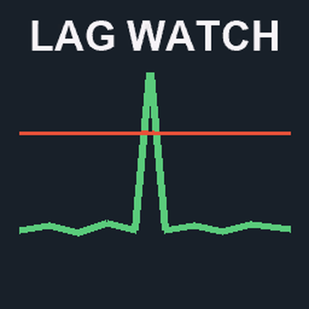

# ModHub upload: Server Lag Watch

What to enter in the GIANTS ModHub upload form for this mod. Each text box below has a copy button on GitHub.



**Mod Icon (512x512):** [`icon_512.png`](icon_512.png)

| Field | Value |
|-------|-------|
| Title English | Server Lag Watch |
| Title German | Server Lag Watch |
| Title French | Server Lag Watch |
| Version | `1` `4` `0` `1` |
| Author | DTM Mods, PropaineX |
| Manufacturer | Lizard |
| Category 1 | Gameplay |
| Category 2 | Not Set |
| Category 3 | Not Set |

## Title English
```text
Server Lag Watch
```

## Title German
```text
Server Lag Watch
```

## Title French
```text
Server Lag Watch
```

## Description English
```text
Finds out which mod freezes your server. Whenever the server stops for longer than a quarter of a second, every player gets a notification with how long it froze and which mod script was the slowest at that moment. The same line goes into the server log, so the cause can be found afterwards.

- Freeze alerts for every freeze over 0.25 s, naming the mod script or the save that caused it.
- Who and where: a slow vehicle or placeable is named with its farm, its driver (player, AI helper or no driver) and where it is (field, farmland or off-field).
- SERVER SAVE: big red letters in the middle of the screen while the server saves.
- SERVER LAG WATCH: big red letters when the server stops answering for 3 seconds, until it answers again.
- Slow file writes during a save are logged by file name.
- Also turns off the profanity filter: chat, names and license plates show exactly what was typed.

How to use: install it on the server and on every player's game. In the server log, look for lines starting with [ServerLagWatch].

Changelog 1.4.0.0:
- Slow vehicle and placeable calls now name the farm, the driver (player, AI helper or no driver) and where it is.
- Implements name the driver of the tractor they are attached to.
```

## Description German
```text
Findet heraus, welche Mod deinen Server einfrieren lässt. Sobald der Server länger als eine Viertelsekunde stehen bleibt, bekommt jeder Spieler eine Benachrichtigung, wie lange er hing und welches Mod-Skript in dem Moment am langsamsten war. Dieselbe Zeile landet im Server-Log, damit die Ursache später gefunden werden kann.

- Meldung bei jedem Hänger über 0,25 s, mit dem Mod-Skript oder dem Speichern als Ursache.
- Wer und wo: Ein langsames Fahrzeug oder platzierbares Objekt wird mit seinem Hof, seinem Fahrer (Spieler, Helfer oder kein Fahrer) und seinem Standort (Feld, Grundstück oder außerhalb) genannt.
- SERVER SAVE: große rote Buchstaben in der Bildschirmmitte, solange der Server speichert.
- SERVER LAG WATCH: große rote Buchstaben, wenn der Server 3 Sekunden nicht antwortet, bis er wieder antwortet.
- Langsame Schreibvorgänge beim Speichern werden mit Dateinamen geloggt.
- Schaltet außerdem den Schimpfwortfilter ab: Chat, Namen und Kennzeichen zeigen genau, was eingegeben wurde.

So geht's: Auf dem Server und bei jedem Spieler installieren. Im Server-Log nach Zeilen suchen, die mit [ServerLagWatch] beginnen.

Changelog 1.4.0.0:
- Langsame Fahrzeuge und platzierbare Objekte nennen jetzt den Hof, den Fahrer (Spieler, Helfer oder kein Fahrer) und den Standort.
- Anbaugeräte nennen den Fahrer des Traktors, an dem sie hängen.
```

## Description French
```text
Trouve quel mod fait geler votre serveur. Dès que le serveur s'arrête plus d'un quart de seconde, chaque joueur reçoit une notification indiquant la durée du gel et le script de mod le plus lent à ce moment-là. La même ligne est écrite dans le journal du serveur, pour retrouver la cause plus tard.

- Alerte pour chaque gel de plus de 0,25 s, avec le script de mod ou la sauvegarde en cause.
- Qui et où : un véhicule ou objet plaçable lent est nommé avec sa ferme, son conducteur (joueur, ouvrier ou aucun conducteur) et sa position (champ, parcelle ou hors champ).
- SERVER SAVE : grandes lettres rouges au milieu de l'écran pendant que le serveur sauvegarde.
- SERVER LAG WATCH : grandes lettres rouges quand le serveur ne répond plus pendant 3 secondes, jusqu'à ce qu'il réponde.
- Les écritures de fichiers lentes pendant une sauvegarde sont notées avec le nom du fichier.
- Désactive aussi le filtre de grossièretés : chat, noms et plaques affichent exactement ce qui a été tapé.

Utilisation : à installer sur le serveur et chez chaque joueur. Dans le journal du serveur, cherchez les lignes qui commencent par [ServerLagWatch].

Changelog 1.4.0.0 :
- Les véhicules et objets plaçables lents indiquent maintenant la ferme, le conducteur (joueur, ouvrier ou aucun conducteur) et la position.
- Les outils attelés indiquent le conducteur du tracteur auquel ils sont attelés.
```

## Before uploading

- The icon was upscaled from 256 px; a native 512 px icon would look sharper on ModHub.
- The mod turns off the game's profanity filter for chat, names and license plates. GIANTS may reject a mod that switches off this filter; owner's decision whether to keep that part in a ModHub version.
- Missing translations in the mod itself: the modDesc title and description and the on-screen messages are English only. The German/French texts here do not add them to the mod.
